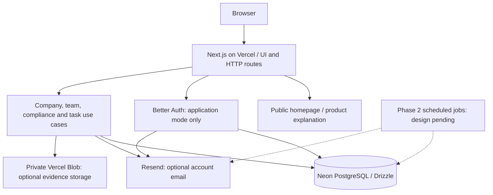

# MCA Software

MCA Software is an independent corporate compliance and practice-management
application for professional firms. It is being built to organize company
records, obligations, assignments, documents, and reviews in one workspace.


## Core Features

Phase 2 — company workspace and team-onboarding increments implemented:

- Operator-provisioned administrator, manager and staff accounts; real sign-in/sign-out.
- Firm chooser and server-side membership checks on every company request.
- Persistent company creation/editing, search, pagination, archiving and restoration.
- Director creation, editing and association removal within the selected company.
- Admin/manager writes and staff read access, enforced by the API.
- Company audit history saved transactionally with each change.

Phase 2B adds:

- Admin-only team management, role changes, access revocation and last-admin protection.
- Email invitations with 72-hour expiry, single-use hashed tokens and cancellation.
- Invite-only account creation; existing accounts join after signing in with the invited email.
- Password recovery with one-hour reset links and revocation of previous sessions.
- Resend email adapter with explicit opt-in, timeout and idempotency keys.
- Database-backed authentication throttling shared across Vercel instances.

The owner has deployed the first increment to [MCA Software](https://mca-software.vercel.app).
Phase 2C adds:

- Company-wise obligations with reusable instruction templates and confirmed deadlines.
- Monthly/quarterly/annual next-occurrence proposals, confirmed one at a time.
- Persistent task creation, assignment, priorities, instructions and date/status filters.
- Assigned-staff progress updates, checklist checks and comments; manager-controlled scope.
- Completion notes, completed-task protection, reopening and transactional activity history.
- Version checks for stale edits, active-member assignment and archived-company protection.

Phase 2D adds:

- Private company/task uploads and authenticated, audited downloads (PDF/PNG/JPEG/TXT, up to 3 MiB).
- Independent review submissions, correction requests, resubmissions and approvals.
- Retained task/checklist/document snapshots and protection against completion without approval.
- Optional private Vercel Blob adapter, upload quotas and explicit partial-failure recovery.

Phase 2E adds:

- Live dashboard counts, upcoming work, pending own reviews and assignee workload.
- Month/day calendar with task dates and confirmed obligation dates, linking to real records.
- Task/obligation reports with due ranges and existing work filters.
- Admin/manager CSV exports with firm checks, spreadsheet text escaping, audit history and limits.
- Refresh-based views using existing data; no simulated dashboard values.

Phases 2B/2C/2D need owner-run migrations and verification before deployment. Resend
configuration is deferred; company and work management operate without email.
The full functional MVP remains in progress.

Public homepage and connected product entry:

- Original public homepage explains the audience, implemented features, workflow and account access.
- Sign in → choose a firm → live dashboard; shared navigation uses the actual firm and role.
- Legacy `/preview` bookmarks enter the real workspace; fictional screens and sample downloads are retired.
- New firms start empty. Counts, calendar entries and reports use saved records.
- The homepage stays public in both runtime modes without querying tenant data.

Implemented foundation:

- Next.js/React/TypeScript application shell with shared Tailwind/shadcn styling.
- Strict runtime configuration and separate liveness/readiness endpoints.
- Better Auth + Drizzle integration; public sign-up disabled, invitation-only onboarding.
- Versioned PostgreSQL schema with 19 tables and tenant/company integrity links.
- Opt-in, transactional seed for five fictional companies and 20 tasks.
- SQL migration/constraint/auth tests, browser workflow/accessibility tests and architecture checks.
- CI, a non-root standalone container recipe, and operational documentation.

Next: owner verification of the public homepage and connected entry, small commits/push/deploy, a separate UI/UX improvement pass, then client workflow verification
and handover (2F). Phase 2E awaits owner-run verification. Email
invitations/recovery/reminders require later sender configuration. Later phases add a client portal, document generation,
and additional reporting, prioritized with the client. AI and advanced government
integrations are outside the current MVP scope. See [delivery phases](docs/roadmap.md).

## Architecture

A root-level **modular monolith**, not separate frontend/API services. Next routes
handle HTTP/UI; company, team, compliance and task use cases own their workflows. Domain code stays
independent of vendors. The initial hosting target is Vercel with Neon PostgreSQL; DigitalOcean is a
later option.



```text
src/
  app/                 # Pages and thin HTTP boundaries
  components/ui/       # Shared UI primitives
  features/marketing/  # Public product explanation; no tenant data
  features/preview/    # Unrouted design references and test fixtures
  styles/              # Shared brand, components and forms
  features/identity/   # Sign-in, invitations and password recovery
  features/workspace/  # Company/team/work forms, tables and API client
  demo/                # Shared deterministic fictional fixture factory
  modules/             # Identity, firms, companies, compliance, tasks, documents, audit
  platform/            # Configuration, auth, database, logging and HTTP helpers
config/                # Architecture and secret-scanning configuration
drizzle/               # Reviewed SQL migrations and snapshots
scripts/               # Explicit migration and fictional seed commands
tests/                 # Unit, DB integration and browser tests
docs/                  # Architecture, decisions, roadmap, contracts and runbooks
infrastructure/        # Optional local DB and later container deployment recipes
```

See [architecture and boundaries](docs/architecture/overview.md),
[decision record](docs/adr/001-foundation.md), and
[security/data handling](docs/security/data-handling.md).

## Setup & Install

Prerequisites: **Node 24.x >=24.11**, npm, and Git. Docker is optional for local
PostgreSQL and required only to build/run the provided deployment containers.
No paid account is needed for the public homepage or embedded database tests.

From your repository checkout:

```bash
node --version
npm ci
cp .env.example .env
npm run dev
```

Open http://localhost:3000/. The public homepage is available in either mode.
The default `APP_MODE=foundation` disables auth and shows an unavailable sign-in
state; readiness deliberately returns 503. Credentials are needed for application mode.

To enable a disposable development database:

1. Set `DATABASE_URL` in `.env` using local PostgreSQL or a development Neon connection string;
   retain TLS parameters. Optionally set a direct `DATABASE_MIGRATION_URL`.
2. Generate a secret with `openssl rand -base64 48` and set `BETTER_AUTH_SECRET`.
3. Run `npm run db:migrate`. Provision the administrator as described below.
4. Set `APP_MODE=application`, restart the server, and choose **Sign in** on `/`.
   Select your firm to open its live dashboard and navigate to company records.
5. For fictional data, explicitly set `SEED_DATABASE_URL` and
   `ALLOW_DEMO_SEED=true`, then run `npm run db:seed`. No passwords or usable
   login accounts are seeded. Never seed a production/client database.

To provision the first administrator, temporarily set these values in the ignored
local `.env`: `ALLOW_ACCOUNT_PROVISIONING=true`, `PROVISION_NAME`,
`PROVISION_EMAIL`, `PROVISION_PASSWORD` (12–128 characters), and
`PROVISION_FIRM_NAME`. Run `npm run account:provision`, then remove the password
and provisioning opt-in. The command creates the firm, credential account,
admin membership and audit event in one transaction; public signup stays disabled.
For another account in an existing firm, replace `PROVISION_FIRM_NAME` with
`PROVISION_FIRM_ID` and choose `PROVISION_ROLE=admin|manager|staff`.
No real account or Neon project is created automatically.

For team onboarding, apply migration `0001_team_onboarding` using `npm run db:migrate`
before running the new app version. Open **Team and access** within your firm.
Email starts disabled: existing login and company records continue to work. To
activate invitations and password recovery, verify a sender domain in Resend and
privately set `EMAIL_DELIVERY=resend`, `RESEND_API_KEY` and `EMAIL_FROM` (a bare
sender address on that domain). Configure these separately in local and Vercel
Production environments; restart/redeploy after changing them. Never commit API keys.
See [Phase 2B setup and verification](docs/runbooks/team-onboarding.md).

For Phase 2C, run `npm run db:migrate` to apply all pending migrations before
restarting/deploying. Open **Obligations** or **Tasks** in the firm navigation.
Create a template or custom obligation, confirm its date, then create and assign
its task. Staff update only assigned work; admins/managers control scope. Keep
`EMAIL_DELIVERY=disabled` while email is deferred. No new API key or dependency is
needed. See [Phase 2C setup and verification](docs/runbooks/work-management.md).

For Phase 2D, run `npm ci` and apply pending migrations before restarting.
Connect a **private** Vercel Blob store and privately set `DOCUMENT_STORAGE=vercel-blob`
and `BLOB_READ_WRITE_TOKEN` to enable uploads. Without storage, use written review
summaries. A second admin/manager account is required for independent review.
See [documents/review setup and owner checks](docs/runbooks/documents-and-review.md).

For Phase 2E, no new setup or migration is required. Choose a firm to open its live
Dashboard; use Calendar or Reports in the firm navigation. Staff can view firm records;
admins/managers can export up to 1,000 filtered rows per CSV. Email reminders remain
planned. See [dashboard/reporting owner checks](docs/runbooks/dashboard-and-reporting.md).

See [local development](docs/runbooks/development.md) for local PostgreSQL,
environment details, seed safeguards and migration review.

| Command                     | Purpose                                                           |
| --------------------------- | ----------------------------------------------------------------- |
| `npm run dev`               | Development server                                                |
| `npm run check`             | Formatting, lint, architecture, strict types and tests            |
| `npm run db:generate`       | Generate SQL from schema changes without DB access                |
| `npm run db:check`          | Check migration metadata consistency                              |
| `npm run db:migrate`        | Explicitly apply migrations to the configured DB                  |
| `npm run account:provision` | Explicit operator account setup in the configured database        |
| `npm run test:workspace`    | Authenticated browser journey against a fresh local test database |
| `npm run db:seed`           | Opt-in fictional fixtures in a selected disposable DB             |
| `npm run test:e2e`          | Chromium workflows, mobile layout and accessibility checks        |
| `npm run build`             | Production build; use explicit production config below            |
| `npm start`                 | Start a production build with runtime configuration               |

For a foundation production build:

```bash
APP_MODE=foundation APP_URL=https://build.example.test npm run build
```

For browser tests, first build the application, then run `npx playwright install chromium`
and `npm run test:e2e`. The browser suite starts/stops a local production server.
Database integration tests execute in-process PostgreSQL using PGlite; they do
not contact Neon or certify provider networking/TLS.
The authenticated browser suite uses a fresh local PostgreSQL database selected
by `WORKSPACE_TEST_DATABASE_URL` (localhost and `mca_workspace_e2e*` names only).
It runs an isolated app copy so an existing development server is left alone.
CI supplies its own disposable PostgreSQL service. CI also audits dependencies and scans tracked source for secrets.

Initial hosting target: **Vercel + Neon PostgreSQL**. Vercel hosts Next.js pages
and server routes; Neon stores persistent application data. Neon can be connected
through the [Vercel Marketplace](https://vercel.com/docs/postgres). Private object
storage is added with the upload workflow; DigitalOcean remains a later option.

`vercel.json` selects Next.js and `next build`, bypassing standalone container
packaging. On Vercel (`VERCEL=1`), `next.config.ts` uses native framework output;
local/container builds retain standalone output. Keep Node 24.x selected. Set
`APP_MODE=application`, the exact HTTPS `APP_URL`, pooled Neon `DATABASE_URL` and
`BETTER_AUTH_SECRET` in the project's environment settings. Apply migrations and
provision the administrator explicitly before delivering the working URL.

See [Vercel setup and release steps](docs/runbooks/vercel-deployment.md).
No infrastructure is provisioned and no deploy runs automatically. See
[deployment and recovery](docs/runbooks/deployment-recovery.md) and
[Phase 0 verification](docs/verification/phase-0.md) and
[Phase 1 verification](docs/verification/phase-1.md) and
[Phase 2 increment verification](docs/verification/phase-2-increment-1.md) for actual checks and limitations.

Tooling configuration: `.nvmrc` selects Node 24; `package.json` contains the
shared Prettier settings. Architecture rules live in
`config/dependency-cruiser.cjs` and are used by `npm run architecture:check`.
Secret-scanning rules live in `config/gitleaks.toml`; CI passes that path
explicitly. Local Gitleaks scans should also use `--config config/gitleaks.toml`.

Dependency maintenance: the `@vercel/cli-config` override reuses the project's
Zod 4.6.7 instead of its vulnerable pinned 4.1.11 dependency. This addresses
[GHSA-mrhx-c7xc-m3w5](https://github.com/advisories/GHSA-mrhx-c7xc-m3w5), whose patched
versions start at 4.6.6, while retaining the private Blob SDK. The repository
maintainer should remove this override when the upstream dependency chain resolves
to a patched Zod version without it, after checking document upload/download behavior.

Owner validation workflow: the coding agent makes changes and reviews them
statically, then hands over test/check commands and manual UI steps. Agent-run
checks require an explicit request. Existing CI checks remain configured.

## Core API / Usage

Public entry walkthrough: open `/`, explore features and workflow, then choose
**Sign in**. In application mode, authenticate and choose your firm to open the live
dashboard. In foundation mode, sign-in explains that access is unavailable.
See [public entry owner checks](docs/runbooks/public-product-entry.md).

```bash
curl -i http://localhost:3000/api/health
# 200: {"status":"ok","service":"mca-software","requestId":"..."}

curl -i http://localhost:3000/api/readiness
# Foundation mode: 503, SERVICE_UNAVAILABLE
# Application mode with migrated reachable database: 200, status=ready
```

Operational errors use stable codes and generated request IDs; credentials and
internal errors are never returned. Auth is mounted at `/api/auth/*`, requires
application configuration, and disallows public sign-up. Company endpoints under
`/api/firms/:firmId/companies` require a session, current membership and the
appropriate role. Read [HTTP contracts](docs/api/contracts.md).

Application walkthrough: sign in, select your firm, add a company, edit its
address, add/edit a director, reload to verify persistence, and inspect activity.
Archiving preserves the records; restore before editing again. Staff can view
company records and cannot change them. For tasks, assigned staff may update progress,
check existing checklist items and comment. Managers/admins create and assign work.

Work walkthrough: create a confirmed obligation, create its task, add checklist
items, assign an active member, record progress/comments, finish the checklist,
submit evidence to another admin/manager for review, address corrections, obtain approval, then provide a completion note and complete. Only an admin/manager can reopen it; reopening requires fresh approval before completion.
Monthly/quarterly/annual recurrence proposes the next date from the original anchor;
a user must confirm each occurrence. This is scheduling, not legal-date verification.
Changing an obligation deadline never silently reschedules its existing tasks.

Phase 1 prototype routes have been retired; the full Phase 2 MVP remains in progress.
REA is optional investigation tooling, not a runtime dependency. Reference
assumptions and unknowns are recorded in [research boundaries](docs/research/reference-boundaries.md).
