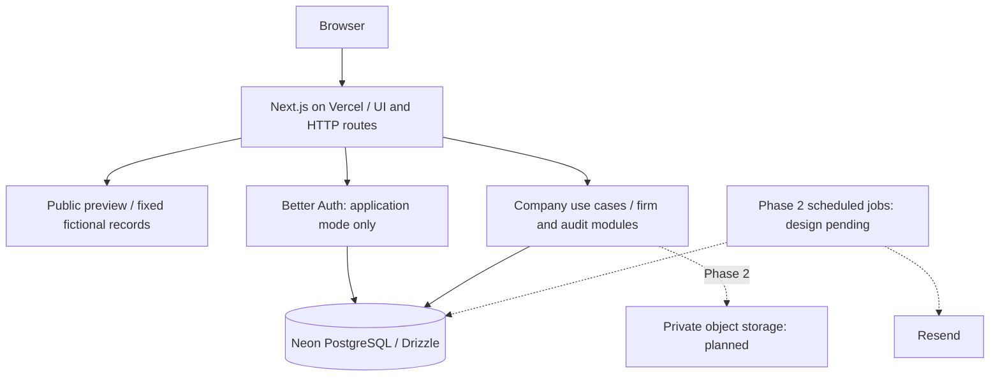

# MCA Software

MCA Software is an independent corporate compliance and practice-management
application for professional firms. It is being built to organize company
records, obligations, assignments, documents, and reviews in one workspace.


## Core Features

Phase 2 — first functional increment implemented locally:

- Operator-provisioned administrator, manager and staff accounts; real sign-in/sign-out.
- Firm chooser and server-side membership checks on every company request.
- Persistent company creation/editing, search, pagination, archiving and restoration.
- Director creation, editing and association removal within the selected company.
- Admin/manager writes and staff read access, enforced by the API.
- Company audit history saved transactionally with each change.

The full functional MVP is still in progress. No hosted evaluation URL is available yet.

Implemented interface preview:

- Responsive workspace with dashboard, company list/details, and director/document sections.
- Searchable company, assignment, compliance and document lists with empty states.
- Monthly calendar with navigation and links to assignments on a selected date.
- Task detail with local checklist, review simulation and sample comments.
- Downloadable fictional text files; firm, team and notification settings layouts.
- Sign-in layout and preview guide; disabled actions explain their future behavior.
- Five fictional companies and 20 assignments using a fixed 22 October 2026 snapshot.

Preview data is public and fixed. Local interactions reset on reload/navigation;
those preview interactions do not use operational login, persistence, uploads or email.
The calendar uses illustrative dates, with no legal-deadline calculation.

Implemented foundation:

- Next.js/React/TypeScript application shell with shared Tailwind/shadcn styling.
- Strict runtime configuration and separate liveness/readiness endpoints.
- Better Auth + Drizzle integration; public sign-up disabled, no onboarding UI yet.
- Versioned PostgreSQL schema with 14 tables and tenant/company integrity links.
- Opt-in, transactional seed for five fictional companies and 20 tasks.
- SQL migration/constraint/auth tests, browser workflow/accessibility tests and architecture checks.
- CI, a non-root standalone container recipe, and operational documentation.

Remaining Phase 2: invitations/reset and team administration; obligation templates,
confirmed dates and recurrence; persistent assignments/checklists/comments; private
documents; reviews, reminders and exports; a hosted evaluation environment. Later phases add a client portal, document generation,
billing, selected MCA integrations and evaluated AI. See [delivery phases](docs/roadmap.md).

## Architecture

A root-level **modular monolith**, not separate frontend/API services. Next routes
handle HTTP/UI; company use cases own company operations; other workflows are planned. Domain code stays
independent of vendors. The initial hosting target is Vercel with Neon PostgreSQL; DigitalOcean is a
later option.



```text
src/
  app/                 # Pages and thin HTTP boundaries
  components/ui/       # Shared UI primitives
  features/preview/    # Isolated sample screens, selectors and local interactions
  features/identity/   # Sign-in/sign-out clients
  features/workspace/  # Authenticated company forms and API client
  demo/                # Shared deterministic fictional fixture factory
  modules/             # Identity, firms, companies, compliance, tasks, documents, audit
  platform/            # Configuration, auth, database, logging and HTTP helpers
config/                # Architecture and secret-scanning configuration
drizzle/               # Reviewed SQL migrations and snapshots
scripts/               # Explicit migration and fictional seed commands
tests/                 # Unit, DB integration and browser tests
docs/                  # Architecture, decisions, roadmap, contracts and runbooks
infrastructure/        # Optional local DB and later container deployment recipes
```

See [architecture and boundaries](docs/architecture/overview.md),
[decision record](docs/adr/001-foundation.md), and
[security/data handling](docs/security/data-handling.md).

## Setup & Install

Prerequisites: **Node 24.x >=24.11**, npm, and Git. Docker is optional for local
PostgreSQL and required only to build/run the provided deployment containers.
No paid account is needed for the preview, migration tests or auth integration tests.

From your repository checkout:

```bash
node --version
npm ci
cp .env.example .env
npm run dev
```

Open http://localhost:3000/preview. The root redirects there. The default
`APP_MODE=foundation` serves the fictional preview;
auth is disabled and readiness deliberately returns 503. This is not a database
failure. Credentials are needed only for application mode.

To enable a disposable development database:

1. Set `DATABASE_URL` in `.env` using local PostgreSQL or a development Neon connection string;
   retain TLS parameters. Optionally set a direct `DATABASE_MIGRATION_URL`.
2. Generate a secret with `openssl rand -base64 48` and set `BETTER_AUTH_SECRET`.
3. Run `npm run db:migrate`. Provision the administrator as described below.
4. Set `APP_MODE=application`, restart the server, and open `/login`. The root now
   routes to `/workspace`. Select your firm to create and manage company records.
5. For fictional data, explicitly set `SEED_DATABASE_URL` and
   `ALLOW_DEMO_SEED=true`, then run `npm run db:seed`. No passwords or usable
   login accounts are seeded. Never seed a production/client database.

To provision the first administrator, temporarily set these values in the ignored
local `.env`: `ALLOW_ACCOUNT_PROVISIONING=true`, `PROVISION_NAME`,
`PROVISION_EMAIL`, `PROVISION_PASSWORD` (12–128 characters), and
`PROVISION_FIRM_NAME`. Run `npm run account:provision`, then remove the password
and provisioning opt-in. The command creates the firm, credential account,
admin membership and audit event in one transaction; public signup stays disabled.
For another account in an existing firm, replace `PROVISION_FIRM_NAME` with
`PROVISION_FIRM_ID` and choose `PROVISION_ROLE=admin|manager|staff`.
No real account or Neon project is created automatically.

See [local development](docs/runbooks/development.md) for local PostgreSQL,
environment details, seed safeguards and migration review.

| Command                     | Purpose                                                           |
| --------------------------- | ----------------------------------------------------------------- |
| `npm run dev`               | Development server                                                |
| `npm run check`             | Formatting, lint, architecture, strict types and tests            |
| `npm run db:generate`       | Generate SQL from schema changes without DB access                |
| `npm run db:check`          | Check migration metadata consistency                              |
| `npm run db:migrate`        | Explicitly apply migrations to the configured DB                  |
| `npm run account:provision` | Explicit operator account setup in the configured database        |
| `npm run test:workspace`    | Authenticated browser journey against a fresh local test database |
| `npm run db:seed`           | Opt-in fictional fixtures in a selected disposable DB             |
| `npm run test:e2e`          | Chromium workflows, mobile layout and accessibility checks        |
| `npm run build`             | Production build; use explicit production config below            |
| `npm start`                 | Start a production build with runtime configuration               |

For a foundation production build:

```bash
APP_MODE=foundation APP_URL=https://build.example.test npm run build
```

For browser tests, first build the application, then run `npx playwright install chromium`
and `npm run test:e2e`. The browser suite starts/stops a local production server.
Database integration tests execute in-process PostgreSQL using PGlite; they do
not contact Neon or certify provider networking/TLS.
The authenticated browser suite uses a fresh local PostgreSQL database selected
by `WORKSPACE_TEST_DATABASE_URL` (localhost and `mca_workspace_e2e*` names only).
It runs an isolated app copy so an existing development server is left alone.
CI supplies its own disposable PostgreSQL service. CI also audits dependencies and scans tracked source for secrets.

Initial hosting target: **Vercel + Neon PostgreSQL**. Vercel hosts Next.js pages
and server routes; Neon stores persistent application data. Neon can be connected
through the [Vercel Marketplace](https://vercel.com/docs/postgres). Private object
storage is added with the upload workflow; DigitalOcean remains a later option.

`vercel.json` selects Next.js and `next build`, bypassing standalone container
packaging. On Vercel (`VERCEL=1`), `next.config.ts` uses native framework output;
local/container builds retain standalone output. Keep Node 24.x selected. Set
`APP_MODE=application`, the exact HTTPS `APP_URL`, pooled Neon `DATABASE_URL` and
`BETTER_AUTH_SECRET` in the project's environment settings. Apply migrations and
provision the administrator explicitly before delivering the working URL.

See [Vercel setup and release steps](docs/runbooks/vercel-deployment.md).
No infrastructure is provisioned and no deploy runs automatically. See
[deployment and recovery](docs/runbooks/deployment-recovery.md) and
[Phase 0 verification](docs/verification/phase-0.md) and
[Phase 1 verification](docs/verification/phase-1.md) and
[Phase 2 increment verification](docs/verification/phase-2-increment-1.md) for actual checks and limitations.

Tooling configuration: `.nvmrc` selects Node 24; `package.json` contains the
shared Prettier settings. Architecture rules live in
`config/dependency-cruiser.cjs` and are used by `npm run architecture:check`.
Secret-scanning rules live in `config/gitleaks.toml`; CI passes that path
explicitly. Local Gitleaks scans should also use `--config config/gitleaks.toml`.

Owner validation workflow: the coding agent makes changes and reviews them
statically, then hands over test/check commands and manual UI steps. Agent-run
checks require an explicit request. Existing CI checks remain configured.

## Core API / Usage

In foundation mode, preview walkthrough: open `/login`, choose **Open sample workspace**, open a
company, explore its assignments, check the remaining checklist items, simulate
a review request and add a sample comment. Reload to restore the original data.
Search and calendar filters are URL-based and can be bookmarked.

```bash
curl -i http://localhost:3000/api/health
# 200: {"status":"ok","service":"mca-software","requestId":"..."}

curl -i http://localhost:3000/api/readiness
# Foundation mode: 503, SERVICE_UNAVAILABLE
# Application mode with migrated reachable database: 200, status=ready
```

Operational errors use stable codes and generated request IDs; credentials and
internal errors are never returned. Auth is mounted at `/api/auth/*`, requires
application configuration, and disallows public sign-up. Company endpoints under
`/api/firms/:firmId/companies` require a session, current membership and the
appropriate role. Read [HTTP contracts](docs/api/contracts.md).

Application walkthrough: sign in, select your firm, add a company, edit its
address, add/edit a director, reload to verify persistence, and inspect activity.
Archiving preserves the records; restore before editing again. Staff can view
these records and cannot change them.

Phase 1 is an interface preview; the full Phase 2 MVP remains in progress.
REA is optional investigation tooling, not a runtime dependency. Reference
assumptions and unknowns are recorded in [research boundaries](docs/research/reference-boundaries.md).
